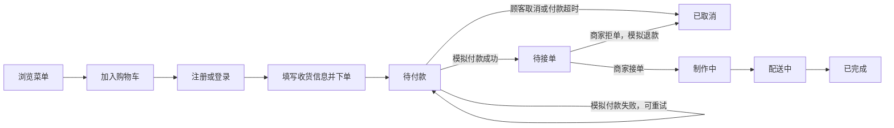

# 甜蜜小厨项目介绍

更新日期：2026-10-16。本文介绍当前已经实现并上线的系统，适合课程答辩、作品展示和项目交接。

## 1. 项目定位与访问

甜蜜小厨是一个单店点餐系统，覆盖顾客从浏览菜单到查询订单、商家从维护菜单到完成订单的主要流程。系统包含前端、后端和真实数据库，支付采用模拟方式。

| 入口 | 地址 |
| --- | --- |
| 在线点餐 | [顾客首页](https://diandan-app-gike2022.onrender.com) |
| 用户注册 | [注册页面](https://diandan-app-gike2022.onrender.com/register) |
| 商家管理 | [商家工作台](https://diandan-app-gike2022.onrender.com/admin) |
| 代码仓库 | [Gike2022/diandan-app](https://github.com/Gike2022/diandan-app) |

登录方式见 [登录账号说明](登录账号说明.md)，运行方法见 [部署说明](部署说明.md)。

## 2. 角色与功能

### 顾客端

| 模块 | 功能 |
| --- | --- |
| 账号 | 注册后自动登录、登录退出、查看当前账号 |
| 菜单 | 从后端加载分类和菜品，分类筛选，展示价格与售罄状态 |
| 购物车 | 添加、移除、修改数量，本地恢复，同来源标签页同步 |
| 结算 | 填写联系人、电话、地址与备注，选择模拟付款方式 |
| 订单 | 下单、继续付款、取消未付款订单、查看详情及分页历史 |
| 再次购买 | 按当前菜单重新核对菜品及价格，恢复可购买内容 |
| 个人资料 | 修改昵称、联系电话和登录密码 |

### 商家端

| 模块 | 功能 |
| --- | --- |
| 分类维护 | 新增、修改名称与排序、启用或停用 |
| 菜品维护 | 新增编辑、设置价格、上下架、售罄、上传图片 |
| 订单查询 | 按完整或部分订单号、北京时间下单日期和状态组合查询 |
| 订单处理 | 接单制作、配送、完成；待接单订单可拒单并记录模拟退款 |
| 新订单提醒 | 每 5 秒同步已付款待接单队列，提示新增订单 |
| 营业统计 | 日期范围筛选、营业额、单量、每日趋势、状态分布和热门菜品 |
| 个人资料 | 维护商家账号的昵称、联系电话和密码 |

注册接口只创建顾客账号。商家权限由后端核验，普通顾客不能通过直接输入管理网址获得管理权限。

## 3. 业务流程

- 新订单默认保留 15 分钟付款时间，截止时间由后端保存。
- 后台默认每 30 秒扫描到期订单，启动和订单查询时补扫；付款时再次检查数据库时间。
- 商家按制作、配送、完成顺序推进状态，不能跳步或回退。
- 新订单提醒采用轮询；切页、刷新后不会将相同待接单订单反复当作新增订单。
- 修改个人资料不会改变历史订单中的收货信息。

## 4. 技术架构

| 层次 | 技术与职责 |
| --- | --- |
| 页面 | React 18 + TypeScript，组织顾客和商家界面 |
| 构建与样式 | Vite 5、Tailwind CSS 4、Radix UI / shadcn 风格组件、Framer Motion |
| 路由与状态 | Wouter；TanStack Query 管理接口数据；Context 管理登录与购物车 |
| 接口服务 | Node.js + TypeScript + Express 5，提供认证、菜单、订单和商家接口 |
| 数据访问 | mysql2 参数化查询、事务与行锁；SQL 文件执行版本迁移 |
| 图片处理 | sharp 校验、压缩并转换为 WebP |
| 数据库 | MySQL；云端使用 Aiven，本机已有 MySQL 服务可独立配置 |
| 部署 | Render 同时提供 React 页面、API 和图片访问 |

前端请求默认使用 `/api`。本地开发由 Vite 转发给 Express；云端由 Express 在同一网站地址下提供页面和接口。

## 5. 数据保存与业务约束

| 数据 | 保存位置与规则 |
| --- | --- |
| 菜单、分类、账户 | MySQL，菜单初始化为 5 个分类和 15 道菜品，后续由商家维护 |
| 订单、明细、模拟支付 | MySQL，查询按用户身份隔离，商家可查看全部订单 |
| 历史商品信息 | 下单时保存名称、图片和价格快照，菜单修改不覆盖旧订单 |
| 金额 | 以整数分存储；后端读取菜单重新计价，每份包装费 50 分 |
| 密码与会话 | 密码保存 scrypt 摘要；随机令牌的 SHA-256 摘要保存在会话表 |
| 购物车和登录令牌 | 浏览器 localStorage，用于恢复当前浏览器状态 |
| 请求恢复信息 | 浏览器 sessionStorage，用于下单或新增菜品结果不明时重试 |
| 上传图片 | 云端写入 MySQL；本机默认保存到项目 `.local/uploads/menu` |

下单使用 `Idempotency-Key` 防止重复创建订单；菜品、分类编辑使用版本检查，防止旧表单覆盖新修改。账户修改密码后撤销所有旧会话，当前页面采用新会话继续登录。

## 6. 页面与访问条件

| 路径 | 页面 | 访问条件 |
| --- | --- | --- |
| `/` | 菜单首页 | 公开 |
| `/cart` | 购物车 | 公开 |
| `/login`、`/register` | 登录、注册 | 公开 |
| `/checkout` | 确认订单 | 已登录 |
| `/orders`、`/orders/:id` | 历史订单、订单详情 | 已登录，后端校验订单归属 |
| `/profile` | 个人资料与修改密码 | 已登录 |
| `/admin` | 商家订单管理 | 管理员 |
| `/admin/menu`、`/admin/categories` | 菜品、分类管理 | 管理员 |
| `/admin/statistics` | 营业统计 | 管理员 |

顾客页面主要适配手机，商家工作台同时支持手机和桌面。视觉使用粉紫渐变、深色星空背景、圆角卡片，保持原有页面风格。

## 7. 验证记录与使用边界

2026-10-16 上线前完成 45 项后端测试、38 项浏览器测试以及前后端类型检查和构建。公网验证覆盖注册、下单、模拟支付、商家处理、历史订单、订单查询、统计、图片、资料和改密；重新部署后订单、图片及账号修改仍保留。

这些记录描述当次验证结果，后续代码变更仍应按 [部署说明](部署说明.md) 执行相应检查。

当前适合课程设计和作品演示。真实收款、配送平台对接、多商家、评价、优惠券、独立地址簿及短信找回密码尚未实现；若用于实际经营，需要按业务需要另行开发并验证。

统计按北京时间的下单日期筛选订单，只将已完成且已付款订单计入营业额；它是模拟业务统计，不应作为真实支付流水或财务凭证。免费主机的休眠、容量和备份安排见 [部署说明](部署说明.md)。

## 8. 阅读导航

- 想运行或部署：阅读 [部署说明](部署说明.md)。
- 想学习代码：阅读 [项目文件分析](项目文件分析.md)。
- 想调用接口：阅读 [API 接口说明](API接口说明.md)。
- 想登录演示：阅读 [登录账号说明](登录账号说明.md)。
